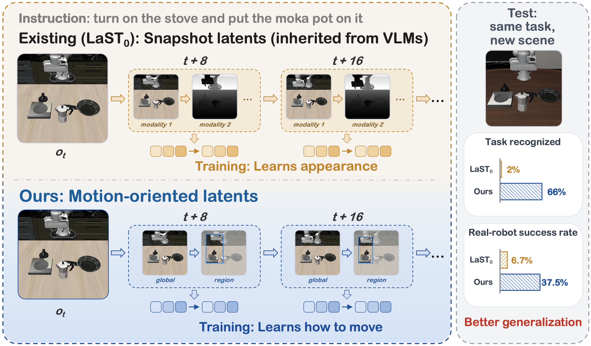
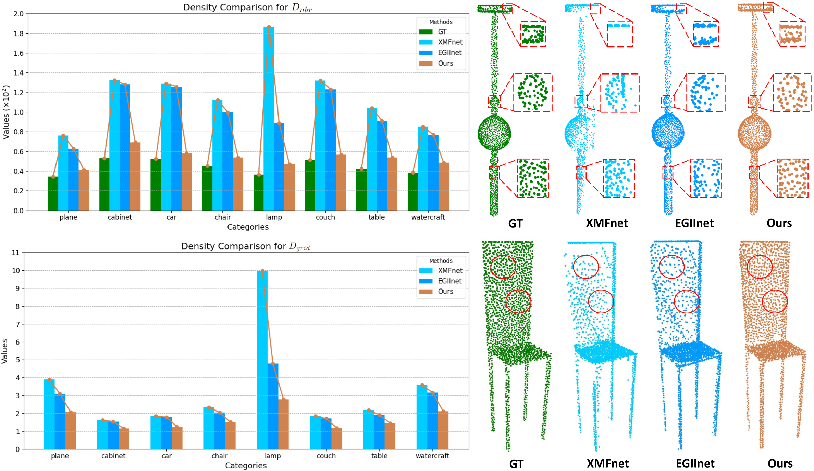
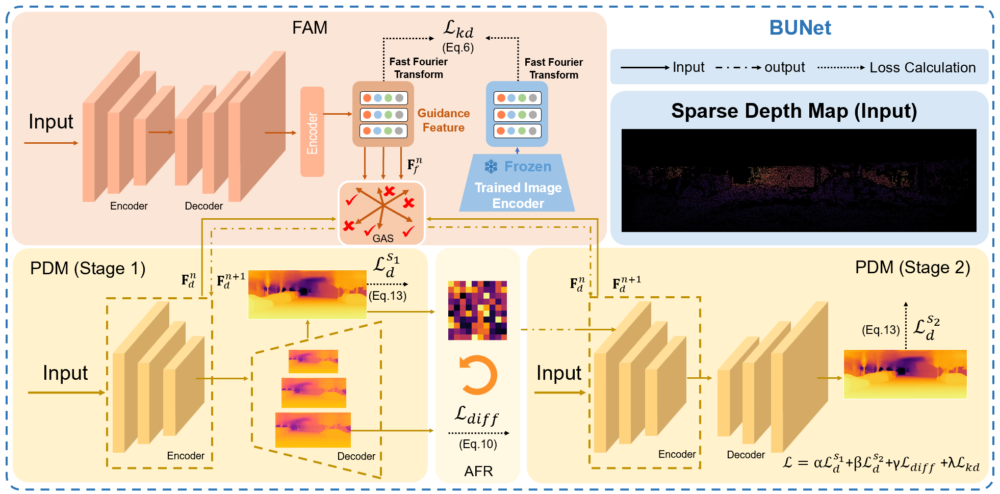
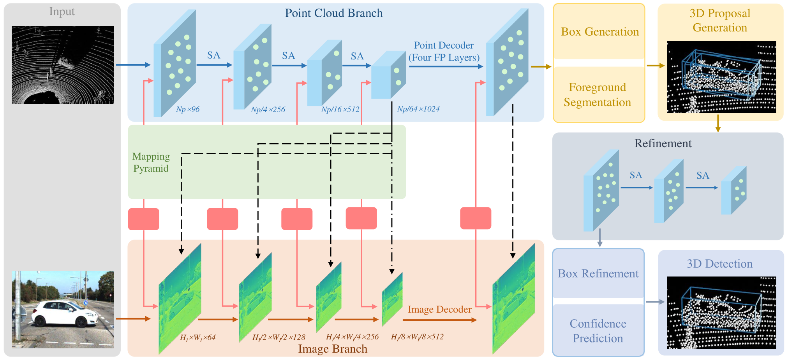
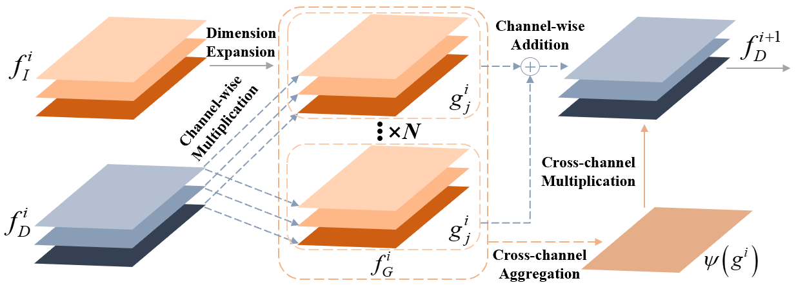
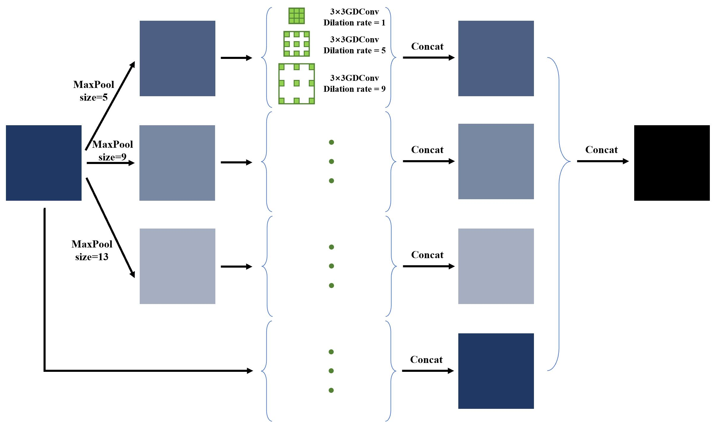
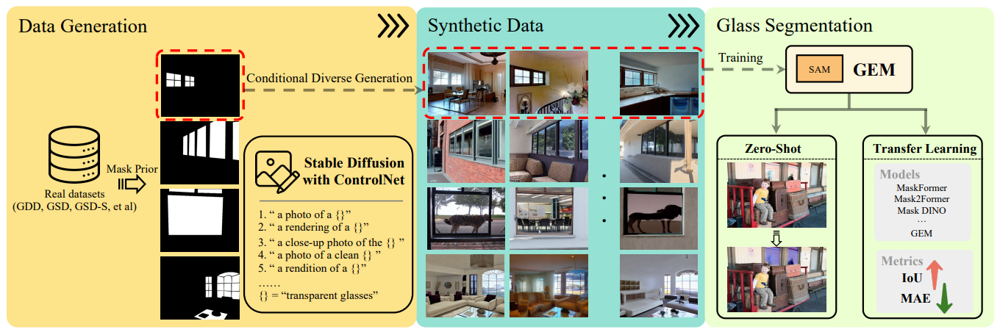

<section class="hero">
  
具身智能 / 人形机器人 / 多模态感知

  <h1 class="hero__title">刘默耘</h1>
  
华中科技大学博士后，研究方向为具身智能、机器人感知与多模态三维理解。

  

    <a class="hero__button" href="https://scholar.google.com/citations?user=5gWDxqAAAAAJ&hl=en">Google Scholar</a>
    <a class="hero__button hero__button--ghost" href="https://github.com/lmomoy">GitHub</a>
    <a class="hero__button hero__button--ghost" href="mailto:lmomoy@hust.edu.cn">邮箱</a>
    <a class="hero__button hero__button--ghost" href="https://orcid.org/0000-0002-4530-2606">ORCID</a>
  

  

    

      <strong>研究方向</strong>
      具身智能与机器人学
    

    <!-- 

      <strong>Recent Venues</strong>
      CVPR, TPAMI, TMM, TITS, Information Fusion
    
 -->
    

      <strong>所在单位</strong>
      华中科技大学智能制造装备与技术全国重点实验室
    

    <a class="hero__stat hero__stat--link" href="#news">
      <strong>征稿信息</strong>
      两个具身智能与机器人操作相关专刊正在征稿
    </a>
  

</section>

我目前在华中科技大学机械科学与工程学院从事博士后研究，与[丁汉教授](https://en-mse.hust.edu.cn/info/1073/1993.htm)（中国科学院院士）、[陶波教授](https://en-mse.hust.edu.cn/info/1089/2064.htm)（长江学者特聘教授）和[赵兴炜教授](https://en-mse.hust.edu.cn/info/1121/2386.htm)（国家优秀青年科学基金获得者）合作开展研究。

我于2021年和2025年在华中科技大学机械科学与工程专业分别获得硕士和博士学位，师从[陈幼平教授](https://baike.baidu.com/item/%E9%99%88%E5%B9%BC%E5%B9%B3/57397)与[谢经明教授](https://mse.hust.edu.cn/info/1145/1415.htm)。2023年至2025年，我在新加坡科技研究局前沿人工智能研究中心（A*STAR CFAR）访学，与[周天异教授](https://joeyzhouty.github.io/)和[杜嘉伟博士](https://scholar.google.com/citations?user=WrJKEzEAAAAJ&hl=zh-CN&oi=ao)合作研究。

我目前的研究兴趣包括具身智能、人形机器人、多模态融合和三维场景理解。

# 研究方向

  

    <h3>具身智能</h3>
    
研究视觉语言模型与多模态推理如何支持基于现实环境的交互、可供性理解和面向任务的行为。

  

  

    <h3>人形机器人</h3>
    
关注能够提升人形机器人场景理解与动作规划能力的感知模块和决策流程。

  

  

    <h3>多模态三维感知</h3>
    
研究涵盖深度补全、三维检测、分割，以及图像、点云和语言之间的跨模态表征学习。

  

# 最新动态

  <ul>
    <li><code>2026.11</code> 🎉 新预印本 “More Than Picturing the Future: Motion-Oriented Latent Reasoning for Generalizable Robot Manipulation” 已发布于 <strong>arXiv</strong>。感谢<a href="https://zhangxin-xd.github.io/">张鑫博士</a>。<a href="https://arxiv.org/abs/2611.29339">论文</a></li>
    <li><code>2026.10</code> ✨ 加入期刊 <a href="https://www.elspub.com/journals/ebi/home"><strong>Embodied and Biomimetic Intelligence</strong></a> 青年编委会。</li>
    <li class="news-list__featured">
      <code>2026.10</code>
      

        征稿中
        📢 担任 <strong>Electronics (MDPI)</strong> 专刊
        <a href="https://www.mdpi.com/journal/electronics/special_issues/9DD0XQUKO7">“Embodied AI: Vision–Language–Action Models, World Models and Beyond”</a>.
        客座编辑，截稿日期为 <strong>2027年6月15日</strong>。
        <a class="news-cta" href="https://www.mdpi.com/journal/electronics/special_issues/9DD0XQUKO7">查看专刊 →</a>
      

    </li>
    <li class="news-list__featured">
      <code>2026.09</code>
      

        征稿中
        📢 担任 <strong>Frontiers in Robotics and AI</strong> 研究专题
        <a href="https://www.frontiersin.org/research-topics/85292/vision-language-action-models-and-world-models-for-robotic-manipulation">“Vision-Language-Action Models and World Models for Robotic Manipulation”</a>.
        客座副编辑，截稿日期为 <strong>2027年3月29日</strong>。
        <a class="news-cta" href="https://www.frontiersin.org/research-topics/85292/vision-language-action-models-and-world-models-for-robotic-manipulation">查看研究专题 →</a>
      

    </li>
    <li><code>2026.09</code> 🎉 论文 “Visual Latents Know More Than They Say: Unsilencing Latent Reasoning in MLLMs” 被 <strong>NeurIPS 2026</strong> 接收。感谢<a href="https://zhangxin-xd.github.io/">张鑫博士</a>。<a href="https://arxiv.org/pdf/2605.02735">论文</a></li>
    <li><code>2026.03</code> 🎉 论文 “Prompt-Driven Lightweight Foundation Model for Instance Segmentation-Based Fault Detection in Freight Trains” 被 <strong>IEEE TITS</strong> 接收。感谢<a href="https://yangzhangcst.github.io/Homepage/">张扬副教授</a>。<a href="https://arxiv.org/pdf/2603.12624v1">论文</a> <a href="https://github.com/MVME-HBUT/SAM_FTI-FDet">代码</a></li>
    <li><code>2026.02</code> 🎉 论文 “HAMMER: Harnessing MLLMs via Cross-Modal Integration for Intention-Driven 3D Affordance Grounding” 被 <strong>CVPR 2026</strong> 接收。感谢<a href="https://rayyoh.github.io/">姚磊先生</a>。<a href="https://rayyoh.github.io/Hammer/">项目主页</a> <a href="https://github.com/RayYoh/Hammer">代码</a></li>
    <li><code>2026.02</code> 🎉 论文 “LaSSM: Efficient Semantic-Spatial Query Decoding via Local Aggregation and State Space Models for 3D Instance Segmentation” 被 <strong>IEEE TCSVT</strong> 接收。感谢<a href="https://rayyoh.github.io/">姚磊先生</a>。<a href="https://arxiv.org/pdf/2602.11007">论文</a> <a href="https://github.com/RayYoh/LaSSM">代码</a></li>
    <li><code>2025.09</code> 🎉 论文 “T-Mamba: A unified framework with Long-Range Dependency in dual-domain for 2D & 3D Tooth Segmentation” 被 <strong>IEEE TMM</strong> 接收。感谢<a href="https://isjinghao.github.io/">郝靖先生</a>。<a href="https://arxiv.org/pdf/2404.01065">论文</a> <a href="https://github.com/isbrycee/T-Mamba">代码</a></li>
    <li><code>2025.08</code> 🎉 论文 “Generalized Probabilistic Graphical Modeling for Multi-view Bipartite Graph Clustering” 被 <strong>IEEE TPAMI</strong> 接收。感谢<a href="https://liliangnudt.github.io/">李亮博士</a>。<a href="https://ieeexplore.ieee.org/document/11119324">论文</a> <a href="https://github.com/liliangnudt/GProM">代码</a></li>
    <li><code>2025.07</code> 🎉 论文 “GaussianCross: Cross-modal Self-supervised 3D Representation Learning via Gaussian Splatting” 被 <strong>ACM MM 2025</strong> 接收。感谢<a href="https://rayyoh.github.io/">姚磊先生</a>。<a href="https://arxiv.org/abs/2508.02172">论文</a> <a href="https://github.com/RayYoh/GaussianCross">代码</a></li>
    <li><code>2025.06</code> 🧑‍🔬 加入华中科技大学<a href="https://dmet.hust.edu.cn/index.htm">智能制造装备与技术全国重点实验室</a>，从事博士后研究。</li>
    <li><code>2025.06</code> 🎓 获得华中科技大学博士学位。</li>
    <li><code>2025.05</code> 🏆 <a href="https://github.com/RayYoh/LaSSM">LaSSM</a> 和 <a href="https://rayyoh.github.io/SGIFormer/">SGIFormer</a> 在 <a href="https://kaldir.vc.in.tum.de/scannetpp/benchmark/insseg">CVPR 2025 ScanNet++ 挑战赛</a>中分获第一名和第二名。</li>
    <li><code>2025.04</code> 🎉 论文 “MAENet: Boost Image-Guided Point Cloud Completion More Accurate and Even” 被 <strong>Information Fusion</strong> 接收。<a href="https://www.sciencedirect.com/science/article/pii/S1566253525002520">论文</a> <a href="https://github.com/lmomoy/MAENet">代码</a></li>
    <li><code>2025.03</code> 🏆 “LF-YOLO” 入选 <strong>ESI 高被引论文</strong>。<a href="https://ieeexplore.ieee.org/abstract/document/10054502">论文</a> <a href="https://github.com/lmomoy/LF-YOLO">代码</a></li>
    <li><code>2024.11</code> 🏅 获博士研究生国家奖学金。</li>
    <li><code>2024.11</code> 🎉 论文 “SGIFormer: Semantic-guided and Geometric-enhanced Interleaving Transformer for 3D Instance Segmentation” 被 <strong>IEEE TCSVT</strong> 接收。感谢<a href="https://rayyoh.github.io/">姚磊先生</a>。<a href="https://arxiv.org/pdf/2407.11564">论文</a> <a href="https://github.com/RayYoh/SGIFormer">代码</a></li>
  </ul>

# 代表性论文

[More Than Picturing the Future: Motion-Oriented Latent Reasoning for Generalizable Robot Manipulation](https://arxiv.org/abs/2611.29339)

Xin Zhang, Yushuo Hou, Anqi Zhao, Moyun Liu 项目负责人, Xingwei Zhao, Bo Tao, Jiawei Du, Joey Tianyi Zhou

**arXiv preprint, 2026**

  <a href="https://arxiv.org/abs/2611.29339">论文</a>

我们提出面向运动的潜在推理方法，指导视觉—语言—动作模型理解场景应如何朝目标状态演化，从而提升机器人操作的泛化能力。

[MAENet: Boost Image-Guided Point Cloud Completion More Accurate and Even](https://www.sciencedirect.com/science/article/pii/S1566253525002520)

Moyun Liu, Ziheng Yang, Bing Chen, Youping Chen, Jingming Xie, Lei Yao, Lap-Pui Chau, Jiawei Du, Joey Tianyi Zhou

**Information Fusion, 2025**

  <a href="https://www.sciencedirect.com/science/article/pii/S1566253525002520">论文</a>
  <a href="https://github.com/lmomoy/MAENet">代码</a>

我们提出一种兼顾几何精度与点分布均匀性的点云补全方法。

[Towards Better Unguided Depth Completion via Cross-Modality Knowledge Distillation in the Frequency Domain](https://ieeexplore.ieee.org/document/10517614)

Moyun Liu, Bing Chen, Youping Chen, Jingming Xie, Lei Yao, Yang Zhang, Qin Hu, Jiawei Du, Joey Tianyi Zhou

**IEEE Transactions on Intelligent Vehicles, 2024**

  <a href="https://ieeexplore.ieee.org/document/10517614">论文</a>

我们重新审视相机信息在深度补全中的作用，并通过频域知识蒸馏构建了性能更强的无引导框架。

[MENet: Multi-Modal Mapping Enhancement Network for 3D Object Detection in Autonomous Driving](https://ieeexplore.ieee.org/document/10510171)

Moyun Liu, Youping Chen, Jingming Xie, Yijie Zhu, Yang Zhang, Lei Yao, Zhenshan Bing, Genghang Zhuang, Kai Huang, Joey Tianyi Zhou

**IEEE Transactions on Intelligent Transportation Systems, 2024**

  <a href="https://ieeexplore.ieee.org/document/10510171">论文</a>

我们提出多模态映射增强网络，以提升自动驾驶场景中的三维目标检测性能。

[A Concise but High-performing Network for Image Guided Depth Completion in Autonomous Driving](https://www.sciencedirect.com/science/article/pii/S0950705124005112)

Moyun Liu, Bing Chen, Youping Chen, Jingming Xie, Lei Yao, Yang Zhang, Joey Tianyi Zhou

**Knowledge-Based Systems, 2024**

  <a href="https://www.sciencedirect.com/science/article/pii/S0950705124005112">论文</a>
  <a href="https://github.com/lmomoy/CHNet">代码</a>

我们设计了一种轻量级深度补全网络，在保持高效的同时充分利用图像引导信息。

[LF-YOLO: A Lighter and Faster YOLO for Weld Defect Detection of X-ray Image](https://arxiv.org/pdf/2110.15045.pdf)

ESI 高被引论文

Moyun Liu, Youping Chen, Jingming Xie, Lei He, Yang Zhang

**IEEE Sensors Journal, 2023**

  <a href="https://arxiv.org/pdf/2110.15045.pdf">论文</a>
  <a href="https://github.com/lmomoy/LF-YOLO">代码</a>

我们提出一种面向焊缝 X 射线图像的高效缺陷检测框架，在速度与精度之间取得良好平衡。

[GEM: Boost Simple Network for Glass Surface Segmentation via Vision Foundation Models](https://arxiv.org/pdf/2307.12018)

Jing Hao*, Moyun Liu*, Jinrong Yang, Kuo Feng Hung

**IEEE Transactions on Multimedia, 2024**

  <a href="https://arxiv.org/pdf/2307.12018">论文</a>
  <a href="https://github.com/isbrycee/GEM">代码</a>

我们展示了如何将视觉基础模型融入简洁的分割流程，以提升对玻璃表面的理解能力。

# 主持或参研项目

<ol class="project-list">
  <li>
    主持
    工信部智能制造系统和机器人国家科技重大专项子课题
  </li>
  <li>
    主持
    中国博士后科学基金面上资助
  </li>
  <li>
    主持
    国家资助博士后研究人员计划
  </li>
  <li>
    技术骨干
    国家自然科学基金重点项目“人形机器人视触觉融合操作与高动态运动控制”
  </li>
  <li>
    技术骨干
    科技部国家重点研发计划“智能机器人”重点专项
  </li>
  <li>
    技术骨干
    教育部“人形机器人学科突破先导项目”
  </li>
</ol>

# 工作经历

  

    
2025.06 - 至今

    

      <strong>博士后</strong> 
      华中科技大学机械科学与工程学院
    

  

  

    
2023.05 - 2025.04

    

      <strong>访问博士生</strong> 
      新加坡科技研究局前沿人工智能研究中心（A*STAR CFAR）
    

  

  

    
2022.07 - 2022.09

    

      <strong>实习生</strong> 
      华为智能汽车解决方案事业部，中国上海
    

  

# 教育经历

  

    
2021.09 - 2025.06

    

      <strong>机械科学与工程博士</strong> 
      华中科技大学
    

  

  

    
2019.06 - 2021.06

    

      <strong>机械科学与工程硕士</strong> 
      华中科技大学
    

  

  

    
2015.09 - 2019.06

    

      <strong>机械工程学士</strong> 
      湖北工业大学
    

  

# 其他论文

  

    <a href="https://arxiv.org/abs/2605.02735"><strong>Visual Latents Know More Than They Say: Unsilencing Latent Reasoning in MLLMs</strong></a>
    NeurIPS, 2026
    
Xin Zhang, Qiqi Tao, Jiawei Du, Moyun Liu, Joey Tianyi Zhou

  

  

    <a href="https://arxiv.org/pdf/2603.12624v1"><strong>Prompt-Driven Lightweight Foundation Model for Instance Segmentation-Based Fault Detection in Freight Trains</strong></a>
    IEEE TITS, 2026
    
Guodong Sun, Qihang Liang, Xingyu Pan, Moyun Liu, and Yang Zhang

  

  

    <a href="https://rayyoh.github.io/Hammer/"><strong>HAMMER: Harnessing MLLMs via Cross-Modal Integration for Intention-Driven 3D Affordance Grounding</strong></a>
    CVPR, 2026
    
Lei Yao, Yong Chen, Yuejiao Su, Yi Wang, Moyun Liu, Lap-Pui Chau

  

  

    <a href="https://arxiv.org/pdf/2602.11007"><strong>LaSSM: Efficient Semantic-Spatial Query Decoding via Local Aggregation and State Space Models for 3D Instance Segmentation</strong></a>
    IEEE TCSVT, 2026
    
Lei Yao, Yi Wang, Yawen Cui, Moyun Liu, Lap-Pui Chau

  

  

    <a href="https://arxiv.org/pdf/2404.01065"><strong>T-Mamba: A unified framework with Long-Range Dependency in dual-domain for 2D & 3D Tooth Segmentation</strong></a>
    IEEE TMM, 2025
    
Jing Hao, Yonghui Zhu, Lei He, Moyun Liu, James Kit Hon Tsoi, Kuo Feng Hung

  

  

    <a href="https://ieeexplore.ieee.org/document/11119324"><strong>Generalized Probabilistic Graphical Modeling for Multi-view Bipartite Graph Clustering</strong></a>
    IEEE TPAMI, 2025
    
Liang Li, Yuangang Pan, Yinghua Yao, Junpu Zhang, Moyun Liu, Xinwang Liu, Kenli Li, Keqin Li

  

  

      <a href="https://arxiv.org/abs/2508.02172"><strong>GaussianCross: Cross-modal Self-supervised 3D Representation Learning via Gaussian Splatting</strong></a>
      ACM MM, 2025
      
Lei Yao, Yi Wang, Yi Zhang, Moyun Liu, Lap-Pui Chau

  

  

      <a href="https://www.sciencedirect.com/science/article/pii/S0952197624009485"><strong>Multiple prior representation learning for self-supervised monocular depth estimation via hybrid transformer</strong></a>
      Engineering Applications of Artificial Intelligence, 2024
      
Guodong Sun, Junjie Liu, Mingxuan Liu, Moyun Liu, Yang Zhou

  

  

      <a href="https://ieeexplore.ieee.org/document/10570157"><strong>Efficient Visual Fault Detection for Freight Train via Neural Architecture Search With Data Volume Robustness</strong></a>
      IEEE TII, 2024
      
Yang Zhang, Mingying Li, Huilin Pan, Moyun Liu, Yang Zhang

  

  

      <a href="https://arxiv.org/pdf/2407.11564"><strong>SGIFormer: Semantic-guided and Geometric-enhanced Interleaving Transformer for 3D Instance Segmentation</strong></a>
      IEEE TCSVT, 2024
      
Lei Yao, Yi Wang, Moyun Liu, Lap-Pui Chau

  

  

      <a href="https://www.sciencedirect.com/science/article/pii/S0262885623002093"><strong>BF3D: Bi-directional fusion 3D detector with semantic sampling and geometric mapping</strong></a>
      Image and Vision Computing, 2023
      
Yijie Zhu, Jingming Xie, Moyun Liu, Lei Yao, Youping Chen

  

  

      <a href="https://ieeexplore.ieee.org/stamp/stamp.jsp?tp=&arnumber=8911418"><strong>Real-time vision-based system of fault detection for freight trains</strong></a>
      IEEE TIM, 2020
      
Yang Zhang, Moyun Liu, Yunian Chen, Hongjie Zhang, Yanwen Guo

  

# 学术服务

  <section class="service-card service-card--wide">
    <h2>编辑工作</h2>
    <ul>
      <li><strong>青年编委</strong>，<a href="https://www.elspub.com/journals/ebi/home"><em>Embodied and Biomimetic Intelligence</em></a></li>
      <li><strong>客座编辑</strong>，Electronics (MDPI) 专刊：<a href="https://www.mdpi.com/journal/electronics/special_issues/9DD0XQUKO7">Embodied AI: Vision–Language–Action Models, World Models and Beyond</a></li>
      <li><strong>客座编辑</strong>，Frontiers in Robotics and AI 研究专题：<a href="https://www.frontiersin.org/research-topics/85292/">Vision-Language-Action Models and World Models for Robotic Manipulation</a></li>
    </ul>
  </section>

  <section class="service-card">
    <h2>期刊审稿</h2>
    <ul>
      <li>IEEE Transactions on Pattern Analysis and Machine Intelligence (IEEE T-PAMI)</li>
      <li>IEEE Transactions on Intelligent Transportation Systems (IEEE T-ITS)</li>
      <li>IEEE Transactions on Intelligent Vehicles (IEEE T-IV)</li>
      <li>IEEE Transactions on Industrial Informatics (IEEE T-II)</li>
      <li>IEEE Transactions on Circuits and Systems for Video Technology (IEEE T-CSVT)</li>
      <li>IEEE Transactions on Automation Science and Engineering (IEEE T-ASE)</li>
      <li>IEEE Sensors Journal</li>
      <li>International Journal of Computer Vision (IJCV)</li>
      <li>Information Fusion</li>
      <li>Pattern Recognition</li>
      <li>Computers in Industry</li>
      <li>Knowledge-Based Systems</li>
      <li>Neurocomputing</li>
      <li>Engineering Applications of Artificial Intelligence</li>
      <li>Expert Systems With Applications</li>
    </ul>
  </section>

  <section class="service-card">
    <h2>会议审稿</h2>
    <ul>
      <li>International Conference on Learning Representations (ICLR)</li>
      <li>IEEE International Conference on Robotics and Automation (ICRA)</li>
      <li>International Conference on Intelligent Robots and Systems (IROS)</li>
      <li>ACM Multimedia (ACM MM)</li>
    </ul>
  </section>

  

